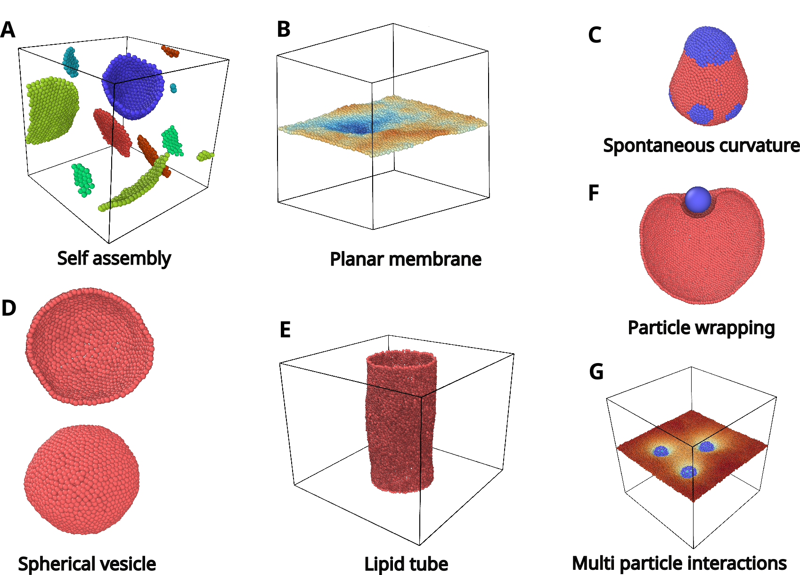

# MesoMem: A Mesoscale Membrane model based on an additive potential

MesoMem is a coarse-grained model of fluid lipid membranes implemented in LAMMPS. The model reproduces fluid, self-assembling membranes with tunable bending rigidity, and it is cheap enough for large membranes and vesicles.

## How to use the model

MesoMem is included in LAMMPS as [`pair_style mesomem/dipole`](https://docs.lammps.org/pair_mesomem_dipole.html) (DIPOLE package), with OpenMP and Kokkos (GPU) accelerated versions. No custom build is needed.

The [`examples/`](examples/) folder has inputs for a flat membrane (`in.planar`), a spherical vesicle (`in.vesicle`) and self-assembly (`in.selfassembly`). Run them from that folder:

```bash
cd examples
mpirun -np 4 lmp -in in.selfassembly -var ktilt 12.0
```

See [`examples/README.md`](examples/README.md) for what each example does and all parameters.

### Key Parameters

| Variable | Description | Typical Range |
| --- | --- | --- |
| `ktilt` | Tilt stiffness | 10.0 - 20.0 |
| `ksplay` | Splay stiffness | 0.5 - 2.0 |
| `rcut` | Interaction cutoff distance | 2.5 - 3.0 |
| `wc` | Cutoff of the tilt and splay energies | 1.8 - `rcut` |

**Visualization:** Use [OVITO](https://www.ovito.org/) to view trajectories, with the dipole vectors shown as the membrane normals.



---

## 📂 Content and Structure

* **`examples/`**: Ready-to-run inputs for a flat membrane, a spherical vesicle and self-assembly, using `pair_style mesomem/dipole` from LAMMPS.
* **`systems/`**: Original research input scripts (`.lmp`) and analysis tools for various physical setups. They use the older `pair_style mesomem` from `cpp_files/`, and their parameters are passed on the command line with `-v`.
  * `planar`: All planar membrane systems.
  * `self_assembly`: Self-assembly simulations from random distributions.
  * `spherical`: Vesicle-related simulations.
  * `volume_control`: Simulations involving osmotic pressure or volume constraints.
  * `wrapping`: Nanoparticle-membrane wrapping studies.
* **`Analysis/`**: Python scripts to analyze LAMMPS trajectory files, in particular for planar systems.
* **`cpp_files/`**: C++ source files for the original membrane potential (`pair_style mesomem`) and a custom pressure compute.
* **`lammps_input_configuration/`**: Python scripts to generate initial configurations (planar, tubes, and spheres).

---

## Publication and citation

**Authors:** Pietro Sillano, Siewert J. Marrink, Timon Idema

**Affiliation:** TU Delft

**Correspondence:** t.idema@tudelft.nl, p.sillano@tudelft.nl

**Publication:** [Phys. Rev. E **114**, 034412 (2026)](https://doi.org/10.1103/4dhv-8xd7) · preprint on [arXiv](https://arxiv.org/abs/2602.24123)

If you use this model or code in your research, please cite the following:

```bibtex
@article{4dhv-8xd7,
  title = {MesoMem: A mesoscale membrane model based on an additive potential},
  author = {Sillano, Pietro and Marrink, Siewert J. and Idema, Timon},
  journal = {Phys. Rev. E},
  volume = {114},
  issue = {3},
  pages = {034412},
  numpages = {11},
  year = {2026},
  month = {Sep},
  publisher = {American Physical Society},
  doi = {10.1103/4dhv-8xd7},
  url = {https://link.aps.org/doi/10.1103/4dhv-8xd7}
}
```

---

## 📄 License

This project is licensed under the **MIT License**. See the `LICENSE` file for details.
